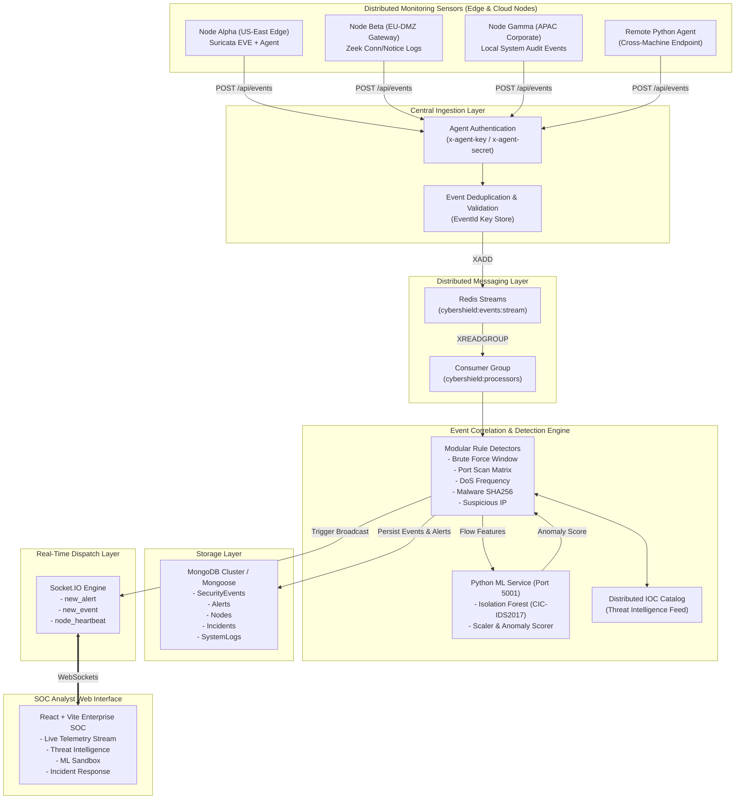

# CyberShield Architecture & Distributed System Design

## 1. System Overview

**CyberShield** is an enterprise-grade distributed cyberattack detection and intrusion prevention platform designed for Security Operations Centers (SOCs). Multiple independent monitoring agents collect and inspect telemetry (local security events, Suricata EVE logs, Zeek logs), stream events into an event processing bus using **Redis Streams**, correlate threats using both heuristic rule modules and an unsupervised **Isolation Forest** machine learning model, store structured telemetry in **MongoDB**, and broadcast alerts to real-time React dashboard clients via **Socket.IO**.

---

## 2. Distributed Architecture Diagram

---

## 3. Communication Breakdown

### A. Agent-to-Server Protocol
- **Transport**: HTTPS / REST with keepalive.
- **Authentication**: Each registered node holds a distinct 24-character cryptographic API key transmitted via header `x-agent-key`.
- **Fault-Tolerance & Buffering**: In the event of network disruption or server restarts, agents buffer security events in an in-memory queue. Once connection is re-established, the buffer flushes with exponential backoff.
- **Heartbeat Protocol**: Nodes issue heartbeats every 15 seconds to `/api/nodes/heartbeat`. If a heartbeat is overdue by >30 seconds (configurable), the central backend flags the node as `OFFLINE` and generates a system log and dashboard notification.

### B. Distributed Message Processing
- **Event Streaming**: Ingested events are not processed synchronously on the HTTP thread; they are appended immediately to `cybershield:events:stream` with `XADD`.
- **Consumer Group Semantics**: Multiple worker processes read from consumer group `cybershield:processors` via `XREADGROUP`, ensuring parallel scalability and at-least-once delivery.
- **Deduplication**: An event ID hash cache (`SET dedup:event:<id> 1 EX 120 NX`) prevents duplicate transmissions from multiple retrying agents.
- **Acknowledgements**: Once an event passes through correlation and database persistence, workers acknowledge with `XACK`.

### C. Detection Engine & ML Isolation
- **Rule Layer**: Evaluates events against threshold state caches (sliding window counters for failed authentications, unique target port sets for port scanning, and requests/sec counters for DoS).
- **ML Layer**: The Python service hosts a trained `IsolationForest` model on 10 flow dimensions normalized with `StandardScaler`. Predictions evaluate anomaly scores in $[0, 1]$ where scores $>0.65$ trigger High severity anomaly alerts.
